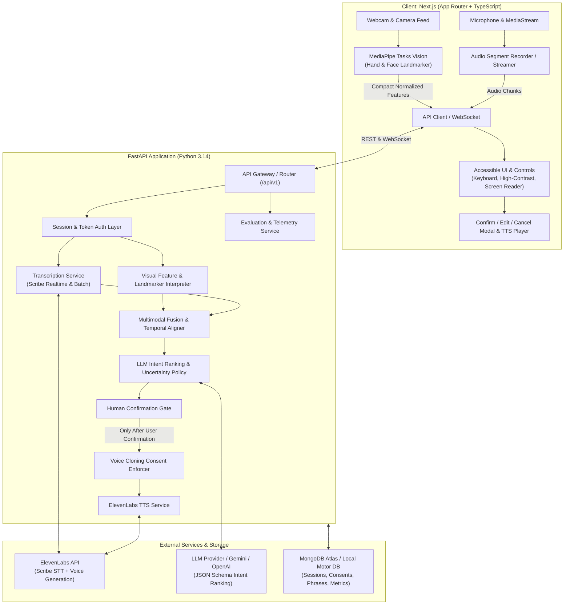

# PS16 - System Architecture

## Architectural Principles
1. **Human-in-the-Loop Supremacy**: The AI generates interpretations and candidate options. No audio speech is ever synthesized until explicit user confirmation or manual edit is received.
2. **On-Device Vision Inference**: Camera frames are processed on-device with MediaPipe to avoid uploading raw video streams to the cloud, minimizing network bandwidth and protecting patient dignity and privacy.
3. **Graceful Multimodal Degradation**: If camera feed or microphone is unavailable, the pipeline smoothly degrades to audio-only, visual-only, or accessible quick-phrase touch-based communication.
4. **Strict Consent Enforcement**: Cloned voices are strictly gated by cryptographically auditable consent records in MongoDB. Revocation takes effect immediately.

